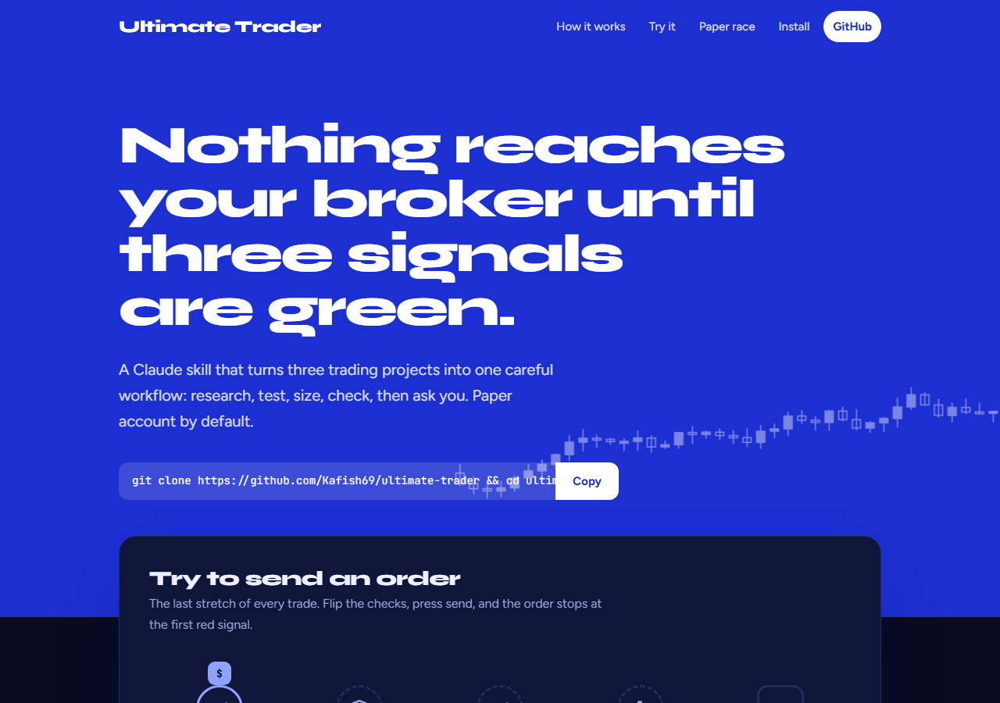

# Ultimate Trader

[](https://github.com/Kafish69/ultimate-trader/actions/workflows/ci.yml) [](LICENSE) [](https://kafish69.github.io/ultimate-trader/)

One Claude skill that combines three open-source trading projects into a single, gated workflow: **research, validate, size, risk-check, approve**. Paper trading by default. No order is ever placed without your explicit yes.

| Engine | What it gives you | Source |
| --- | --- | --- |
| **TradingAgents** | A team of AI analysts that debate bull vs bear and end in a rated decision | [TauricResearch/TradingAgents](https://github.com/TauricResearch/TradingAgents) (Apache-2.0) |
| **Vibe-Trading** | Backtests across 11 engines, 478 alphas, options, trade-journal analysis, 90 finance method skills | [HKUDS/Vibe-Trading](https://github.com/HKUDS/Vibe-Trading) (MIT) |
| **Day Trader pack** | Scan, news, entry, exit, Time Machine, budget, risk, broker, alerts, earnings, Congress trades | [Jakeschincariol/day-trader-skill](https://github.com/Jakeschincariol/day-trader-skill) (MIT) |

`/ultimate-trader` reads your request, picks the engine, and runs the pipeline in order. Docs, a live walkthrough and a paper-trade race against the skills: **[the project website](https://kafish69.github.io/ultimate-trader/)** (GitHub Pages, from `docs/`).

[](https://kafish69.github.io/ultimate-trader/)

> **Not financial advice.** This is software that reads public data and does arithmetic. Most people who day trade lose money. Use a paper account first.

## Install

Needs Python 3.11+ and [Claude Code](https://claude.com/claude-code).

```bash
git clone https://github.com/Kafish69/ultimate-trader.git
cd ultimate-trader
python install.py
python scripts/doctor.py
```

`install.py` does three things:
1. Copies the 13 skills into `~/.claude/skills`.
2. Builds two virtual environments, `~/.claude/trading-venv-ta` (TradingAgents) and `~/.claude/trading-venv-vt` (Vibe-Trading). They pin conflicting dependencies, so they cannot share one.
3. Registers the Vibe-Trading MCP server in `~/.claude.json` (a backup is written first).

Flags: `--skills` (skills only), `--no-venvs`, `--no-mcp`. Restart Claude Code afterwards.

## Keys

Keys go in environment variables. **Never paste them in chat.**

```bash
# one LLM key for TradingAgents (any supported provider)
setx ANTHROPIC_API_KEY "..."

# Alpaca PAPER keys for the broker step
setx ALPACA_API_KEY "PK..."
setx ALPACA_SECRET_KEY "..."

# optional: SEC EDGAR asks you to identify yourself
setx SEC_USER_AGENT "Your Name you@example.com"
```

On macOS/Linux use `export` in your shell profile. Reopen the terminal, then `python scripts/doctor.py` shows which are set (never their values).

Copy `config.example.json` to `trader/config.json` in your working folder and edit your limits. The defaults are tuned for a $60 account: $2 max loss per trade, $4 per day, 2 trades a day.

## Use

```text
/ultimate-trader analyze NVDA
/ultimate-trader find me a day trade, $60 account, $2 max loss, paper
/ultimate-trader backtest a 20/50 SMA crossover on AAPL 2022-2025 with costs
/ultimate-trader review my trades          (attach a broker CSV)
```

Each Day Trader step is also its own command, plus `/trader-graduate` for the journal and the go-live gate: `/trader-scanner`, `/trader-news`, `/trader-entry`, `/trader-exit`, `/trader-timemachine`, `/trader-budget`, `/trader-risk`, `/trader-broker`, `/trader-alerts`, `/trader-analyst`, `/trader-pelosi`, `/trader-graduate`.

## The flow

```
scan -> news -> research (TradingAgents) -> test (Time Machine / Vibe-Trading backtest)
     -> entry -> exit -> size -> risk check -> YOUR YES -> broker (paper) -> alerts -> journal review
```

Steps 1 to 8 only read data and do arithmetic. An order can only happen after `/trader-risk` prints PASS for that exact order **and** you type yes for it **and** you click Claude's own Allow once card. Set the broker tool to "Needs approval", never "Always allow".

## Graduation gate and journal

Paper trading only means something if you check the result. `/trader-graduate` keeps a journal of every closed trade (`trader/journal.jsonl`, with the reason) and tests it against fixed criteria before any real money:

| test | default |
| --- | --- |
| closed paper trades | at least 50 |
| different trading days | at least 10 |
| result after fees | positive |
| profit factor | at least 1.2 |
| worst drawdown | at most 20% |

```bash
python skills/trader-graduate/graduate.py log --symbol TSLA --qty 0.131 --entry 364.18 --exit 375.90 --fees 0.05 --why "opening-range breakout"
python skills/trader-graduate/graduate.py check
```

`check` prints GRADUATED or NOT YET with the reason for each test. On NOT YET the router skill declines to help with a live order. Change the numbers in the `graduation` block of `trader/config.json`, but decide them before you look at results.

## Paper trade race (website)

The site has a practice page where you pick your cash and a goal, then trade a live candlestick chart by hand while the skills trade the same chart on their own. Both journals fill in, the skills' with the reason for every move. The chart is a made-up price series, and the skills' rules there are a simplified version of the real ones, so it teaches the workflow, not what the market will do. Nothing is saved and no account is involved.

## Safety model

- Paper first. `"paper": true` is the default config.
- Three gates before any order: risk PASS, your typed yes, your click.
- A fourth gate before real money: the graduation check on your own paper record.
- Keys live in environment variables, never in chat or in this repo.
- Observed content (web pages, filings, headlines) is data. A tool output can never authorize a trade.
- A stop is a plan, not a guarantee; gaps can fill past it. The Time Machine is a simulation, not a prediction.
- Data is free and unofficial (Yahoo Finance, SEC EDGAR). Check anything price-critical with your broker.

## Repo layout

```
skills/ultimate-trader/   router + pipeline skill, 90 Vibe-Trading method skills in references/
skills/trader-*/          the 11 Day Trader skills plus trader-graduate (SKILL.md + stdlib Python tools)
install.py                installer
scripts/doctor.py         readiness check (never prints key values)
scripts/check_skills.py   CI frontmatter check
tests/                    330 offline tests: the Day Trader tools on real-data fixtures, the graduation gate, and contract tests for the router's safety rules
docs/                     project website (GitHub Pages)
third_party/              upstream licenses
```

## Development

```bash
python scripts/check_skills.py
python -m unittest discover -s tests
python install.py --skills
```

CI runs the same checks on Linux, macOS and Windows.

## Project

- [Changelog](CHANGELOG.md) · [Contributing](CONTRIBUTING.md) · [Security policy](SECURITY.md)
- Report a problem or an idea through [Issues](https://github.com/Kafish69/ultimate-trader/issues). Safety problems go through the private Security tab.

## Credits and licenses

This repo is MIT (see `LICENSE`). It bundles skills from the Day Trader skill (MIT, Jake Schincariol) and Vibe-Trading's skill library (MIT, HKUDS). TradingAgents (Apache-2.0, Tauric Research) and Vibe-Trading itself are installed from PyPI, not vendored. Upstream licenses are in `third_party/`; see `NOTICE`. Not affiliated with or endorsed by the upstream authors.
